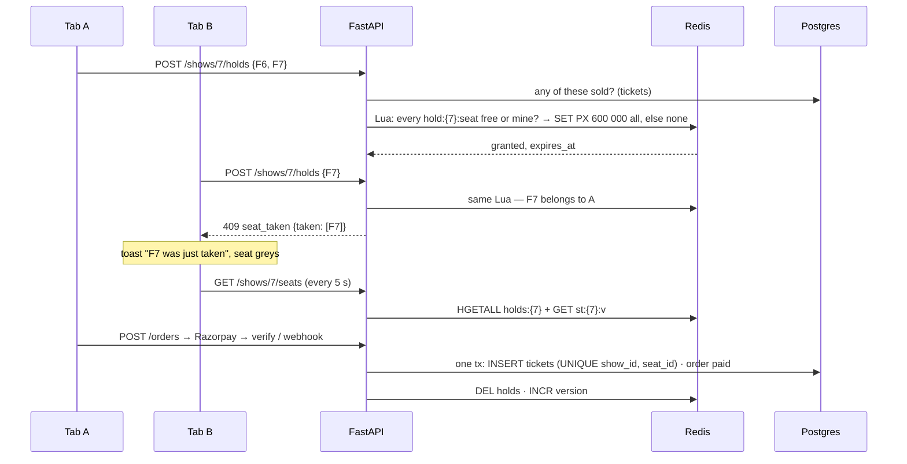

# Frontrow

**Pick your seat, live.** A movie ticketing marketplace for Bengaluru with a live seat map: a seat is held for 10 minutes the moment you tap it and greys out for everyone else. Cinemas run their shows on it; Frontrow staff run the marketplace.

> Status: **v1 Box office built (2026-11-26) — movies only, three roles.** Customers find a film, pick a show and seats on a live map with 10-minute holds, sign in with an emailed code, pay (Razorpay test mode or a labelled test payment) and get one QR per seat. Theatre owners register, set up cinemas and screens, schedule a month of shows in one go, see bookings and scan tickets at the door. Frontrow staff keep the film catalogue, answer film requests and approve new cinemas. One of four portfolio projects by [Viraj Domadia](https://virajdomadia.vercel.app). **Live:** https://frontrow-viraj.vercel.app — moving to `frontrow.virajdomadia.com`.

## What it proves
Concurrency-safe seat holds (Redis Lua, all-or-none) · a Postgres unique guard on confirm · idempotent Razorpay webhooks incl. paid-after-expiry refunds · counter and online sales on one live map · a three-sided marketplace (customers, theatre owners, staff) with per-business access · live updates on serverless inside free tiers · a showcase-grade SVG seat map

## Versions
| | Ships | ~Hours |
|---|---|---|
| **v1 Box office** | Customer: BookMyShow's flow with an email code (home, movie, language/format, showtimes, how many seats, seat map + holds, Razorpay, M-ticket). Theatre owner: register, cinemas, screens, pick films, bulk shows, bookings, door scanning. Staff: film catalogue, requests, approvals | 26 left (+7 built) |
| **v2 Live hall** | Live seats, "Try it live" on the landing page, today board with live sales, blocked seats, counter sales, cancel a show; staff support, suspend, marketplace view | 13.75 |
| **v3 Full house** | Reviews after scan-in, waitlist, sales reports, payouts, seat heatmap, review moderation | 10 |
| **v4 In your pocket** | One Expo app, tabs per role: customer booking + offline wallet + push; owner scanner with multi-scanner door check-in (server-authorised online; provisional offline scans synced, duplicates flagged), today board, counter; staff approvals + support | 20.5 |

## How the hold engine works
Two people, one seat, the same second — exactly one gets it.



- **Holds live only in Redis** (`api/app/services/holds.py`). One Lua script checks every requested `hold:{show}:{seat}` key and sets them all or none, so there is no window between check and set. One holder's seats share one deadline: the clock starts at the first tap. A `holds:{show}` hash mirrors them for a one-round-trip snapshot, and `st:{show}:v` counts every change (v2's stream diffs on it). Holds are keyed on an anonymous `fr_sid` cookie, so a visitor can hold before signing in and keeps the seats after.
- **Sales live only in Postgres.** `tickets` has `UNIQUE (show_id, seat_id)`; confirming an order inserts its tickets in one transaction under a row lock on the order. Redis is the fast path, Postgres is the guard: even if a hold lapses mid-payment, a seat cannot be sold twice.
- **Payments are idempotent.** The Checkout `verify` call, the Razorpay webhook (HMAC-checked, deduplicated by event id) and the demo payment all call the same `confirm()`; whichever lands first issues tickets, the rest are no-ops.
- **Paid after the hold expired:** seats still free → sold anyway; someone else bought one meanwhile → the insert hits the unique constraint, the payment is refunded through Razorpay and the order shows "refunded — seat sold".
- Proven by tests that run in CI: 20 concurrent holders → exactly one wins; all-or-none; expiry; two orders paid for one seat → one ticket + one refund; webhook signature + replay; both paid-after-expiry branches; server-side totals.

## Stack
`web/` Next.js 15 (App Router) · TypeScript · Tailwind 4 — `api/` FastAPI (Python 3.12) · SQLAlchemy + Alembic · Neon Postgres · Upstash Redis · Razorpay · Gmail SMTP — Vercel for both — `mobile/` (v4) Expo · React Native · TypeScript

## Live artifacts
[Tracker](https://claude.ai/artifact/SYCP9jsFMK9fgkoyCyq8DA) — plan v1–v4 by role with row status, every doc rendered, mockups, project data

## Docs (steps 1–7)
[PRD](PRD.md) · [Requirements](docs/03-requirements.md) · [User flows + screen index](docs/03-user-flows.md) · [Technical design](docs/04-technical-design.md) · [UI mockups](docs/04-ui-mockups.md) · [Architecture](docs/05-architecture.md) · [Data + API](docs/06-data-and-api.md) · [Development plan](docs/07-plan.md)

## In this repo
```
web/        Next.js app — customer site, owner console (/owner), staff console (/staff), seat map, typed api client, CC photos (public/img)
api/        FastAPI backend — models + Alembic, screen templates, hold engine, orders/payments, email codes, seed (python -m app.seed)
mobile/     Expo app — arrives in v4
docs/       lifecycle steps 3–7 (re-planned 2026-11-15/16)
mockups/    direction-variants.html (B chosen) · screens.html + landing.html (before the re-plan) · img/ CC photos
brand/      logo, mark, favicon
PRD.md      product requirements with locked decisions
```

### Run it
```
# api — needs Postgres (api/.env.example has a local URL); uv installs Python 3.12
cd api && uv sync && cp .env.example .env.local
uv run alembic upgrade head && uv run python -m app.seed      # seed is idempotent
uv run uvicorn app.main:app --reload --port 8002               # http://localhost:8002/docs

# web — proxies /api/* to API_URL (web/.env.example)
cd web && pnpm install && cp .env.example .env.local && pnpm dev

pnpm gen:api   # in web/: regenerate api/openapi.json + src/lib/api-types.ts after changing the contract
```
Sign-in is by emailed 6-digit code only — three doors: `/sign-in` (customers), `/business` (theatre owners), `/staff` (hidden; seeded staff only, `STAFF_EMAILS`). Locally, with no `SMTP_*` set, the code is printed in the api log. The home page has one-click demo buttons for all three roles: the demo customer (always has an upcoming and a past booking), the demo theatre owner (Orbit Cinemas, view only, customer details masked) and demo staff (view only, owner contacts masked). What visitors book as the demo customer is undone on a later demo sign-in.

The catalogue is real films (Hindi and Hollywood in Indian cinemas, late Nov 2026 – Jan 2027: `api/app/seed/content.py`) at fictional cinemas; posters are original typographic art (`api/scripts/make_posters.py`), never studio artwork. It never empties: seeded cinemas have open-ended weekly schedules whose shows are created 14 days ahead the first time someone reads after the horizon moves (no cron, no reseed), and a coming-soon film gets shows from its release date and turns now-showing that day. `python -m app.seed` is idempotent and never deletes shows of current films; it retires the films listed in `RETIRED_FILMS` (keeping only shows a real visitor holds tickets for).

Payments: with `RAZORPAY_KEY_ID` + `RAZORPAY_KEY_SECRET` set on the api, checkout opens Razorpay in test mode (card 4111 1111 1111 1111). Without them the api runs a built-in demo gateway: checkout shows a clearly-labelled test payment that confirms through the same code path as the webhook.

Tests: `cd api && TEST_DATABASE_URL=… TEST_REDIS_URL=redis://localhost:6379/15 uv run pytest` (86) · `cd web && pnpm test` (20).

Ports 3000/8000 are used by another project on this machine, so the examples use 8002.

### Deploy
GitHub Actions only: `.github/workflows/vercel.yml` builds both apps on GitHub's runner after CI passes on `main` and uploads the output to Vercel. Vercel's Git deployments are off (`git.deploymentEnabled: false` in `api/vercel.json` and `web/vercel.json`), so pushing never starts a Vercel build.
