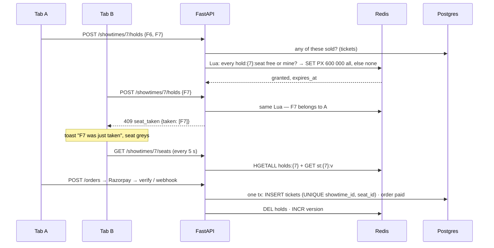

# Frontrow

**Pick your seat, live.** Movie and concert ticketing for Bengaluru with a live seat map: seats are held for 10 minutes the moment you tap them and grey out for everyone else.

> Status: **v1 Box office feature-complete (2026-11-26)** — browse, live seat map with 10-minute Redis holds, sign-in, checkout (Razorpay test mode, or a labelled test payment when no keys are set), QR tickets, my tickets, and the organiser console. v2 (SSE live hall) next. One of six portfolio projects by [Viraj Domadia](https://virajdomadia.vercel.app). **Live (landing page):** https://frontrow-viraj.vercel.app — will move to `frontrow.virajdomadia.com`.

## What it proves
Concurrency-safe seat holds (Redis Lua, all-or-none) · a Postgres unique guard on confirm · idempotent Razorpay webhooks incl. paid-after-expiry refunds · realtime over SSE on serverless · a showcase-grade SVG seat map for three venue templates

## Versions
| | Ships | ~Hours |
|---|---|---|
| **v1 Box office** (base) | Browse, event page, seat map, 10-min holds, Razorpay, QR ticket, my tickets, organiser console (venues from templates, events, showtimes, bookings) | 18 |
| **v2 Live hall** (mid) | Realtime seat state (two-tab demo), live sales dashboard, QR check-in, ticket email | 10 |
| **v3 Full house** (advanced) | Waitlist with auto-offer, best-available pick, dynamic pricing, seat-view preview, ticket transfer, seat heatmap | 10 |
| **v4 In your pocket** (mobile app) | Expo (React Native) app on the same API: seat map with gestures, offline QR wallet, push for expiring holds, multi-scanner door check-in (server-authorised online; provisional offline scans synced, duplicates flagged) | 16 |

## How the hold engine works
Two people, one seat, the same second — exactly one gets it.



- **Holds live only in Redis** (`api/app/services/holds.py`). One Lua script checks every requested `hold:{showtime}:{seat}` key and sets them all or none, so there is no window between check and set. One holder's seats share one deadline: the clock starts at the first tap. A `holds:{showtime}` hash mirrors them for a one-round-trip snapshot, and `st:{showtime}:v` counts every change (v2's stream diffs on it). Holds are keyed on an anonymous `fr_sid` cookie, so a visitor can hold before signing in and keeps the seats after.
- **Sales live only in Postgres.** `tickets` has `UNIQUE (showtime_id, seat_id)`; confirming an order inserts its tickets in one transaction under a row lock on the order. Redis is the fast path, Postgres is the guard: even if a hold lapses mid-payment, a seat cannot be sold twice.
- **Payments are idempotent.** The Checkout `verify` call, the Razorpay webhook (HMAC-checked, deduplicated by event id) and the demo payment all call the same `confirm()`; whichever lands first issues tickets, the rest are no-ops.
- **Paid after the hold expired:** seats still free → sold anyway; someone else bought one meanwhile → the insert hits the unique constraint, the payment is refunded through Razorpay and the order shows "refunded — seat sold".
- Proven by tests that run in CI: 20 concurrent holders → exactly one wins; all-or-none; expiry; two orders paid for one seat → one ticket + one refund; webhook signature + replay; both paid-after-expiry branches; server-side totals.

## Stack
`web/` Next.js 15 (App Router) · TypeScript · Tailwind 4 — `api/` FastAPI (Python 3.12) · SQLAlchemy + Alembic · Neon Postgres · Upstash Redis · Razorpay · Resend — Vercel for both — `mobile/` (v4) Expo · React Native · TypeScript

## Live artifacts
[Tracker](https://claude.ai/artifact/SYCP9jsFMK9fgkoyCyq8DA) — plan v1–v4 with row status, every doc rendered, mockups live, project data · [Screens](https://claude.ai/artifact/MCedtstCq6C2o7d9vJacPp) — all 13 v1 screens in direction B · [Direction variants](https://claude.ai/artifact/LFJw5Zg1LEvvYjqdhot2Dr) — A/B/C/D, B chosen 2026-09-15

## Docs (steps 1–7)
[PRD](PRD.md) · [Requirements](docs/03-requirements.md) · [User flows + screen index](docs/03-user-flows.md) · [Technical design](docs/04-technical-design.md) · [UI mockups](docs/04-ui-mockups.md) · [Architecture](docs/05-architecture.md) · [Data + API](docs/06-data-and-api.md) · [Development plan](docs/07-plan.md)

## In this repo
```
web/        Next.js app — landing page, typed api client (src/lib/api.ts), seed photos (public/img)
api/        FastAPI backend — models + Alembic, layout generators, seed (python -m app.seed)
mobile/     Expo app — arrives in v4
docs/       lifecycle steps 3–7
mockups/    landing.html (ported to web/) · direction-variants.html (A–D, B chosen) · screens.html (all v1 screens) · img/ CC photos
brand/      logo, mark, favicon
PRD.md      product requirements v1 with locked decisions
```

### Run it
```
# api — needs Postgres (api/.env.example has a local URL); uv installs Python 3.12
cd api && uv sync && cp .env.example .env.local
uv run alembic upgrade head && uv run python -m app.seed      # seed is idempotent
uv run uvicorn app.main:app --reload --port 8000               # http://localhost:8000/docs

# web — proxies /api/* to API_URL (web/.env.example)
cd web && pnpm install && cp .env.example .env.local && pnpm dev

pnpm gen:api   # in web/: regenerate api/openapi.json + src/lib/api-types.ts after changing the contract
```
Demo logins (seeded): `customer@frontrow.demo` / `organiser@frontrow.demo`, password `frontrow-demo` — or the one-click demo buttons on the landing page.

Payments: with `RAZORPAY_KEY_ID` + `RAZORPAY_KEY_SECRET` set on the api, checkout opens Razorpay in test mode (card 4111 1111 1111 1111). Without them the api runs a built-in demo gateway: checkout shows a clearly-labelled test payment that confirms through the same code path as the webhook.

Tests: `cd api && TEST_DATABASE_URL=… TEST_REDIS_URL=redis://localhost:6379/15 uv run pytest` · `cd web && pnpm test`.
