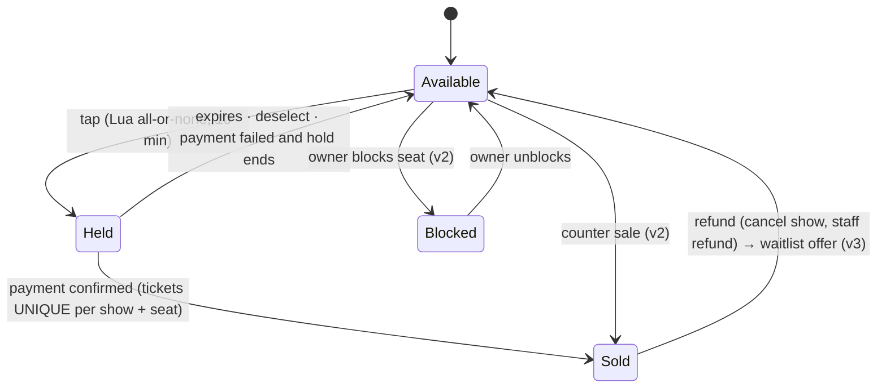
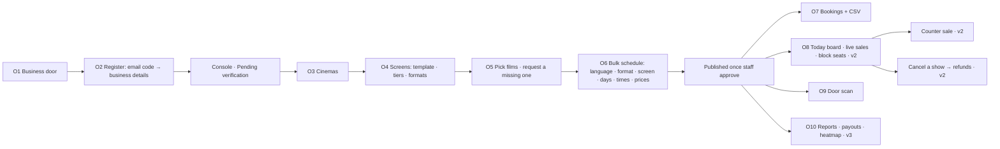
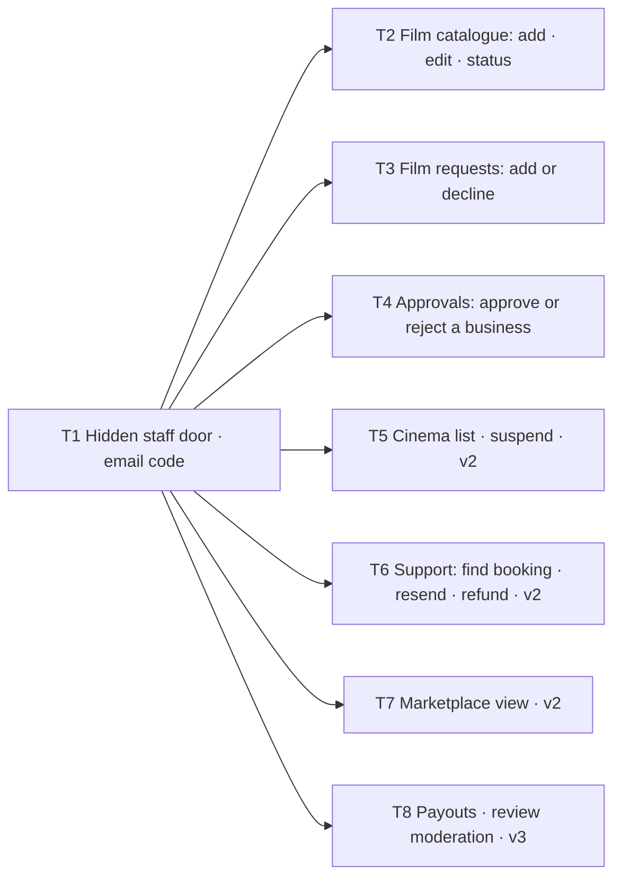

# Frontrow — User Flows & Screen Index

**Lifecycle step:** 3 of 17 · **Re-planned:** 2026-11-15/16 · Pairs with [03-requirements.md](03-requirements.md).

## Flow 1 — Customer books a film (BookMyShow's flow, email code, no city, no add-ons)

```mermaid
flowchart LR
  H[C1 Home<br/>Now showing · search] --> M[C2 Movie page]
  M -->|Book tickets| L{more than one<br/>language/format?}
  L -->|yes| LF[C3 Language + format] --> S
  L -->|no| S[C4 Showtimes<br/>date strip · cinemas · colours]
  S -->|pick a time| N[C5 Certificate notice if A<br/>→ How many seats?]
  N --> SM[C6 Seat map<br/>picks seats together · 10-min hold]
  SM -->|Proceed| IN{signed in?}
  IN -->|no| SI[C7 Email → code → name if new] --> SU
  IN -->|yes| SU[C8 Summary<br/>fee shown · test card note]
  SU -->|Pay| RZ[Razorpay]
  RZ -->|success| CF[Confirming…] --> T[C9 M-ticket · QR per seat · email]
  RZ -->|failed| SU
  CF -->|seat sold meanwhile| RF[C10 Refunded page]
  T --> MT[C11 My tickets]
  T -->|at the cinema| D[O9 Door scan] --> R[C12 Review · v3]
```

## Flow 2 — Hold lifecycle

## Flow 3 — Paid after the hold expired
Webhook → signature + new event id? → holds still ours → sell. Holds gone → seats still free in Postgres → sell anyway. A seat already sold → full Razorpay refund, order `refunded`, customer sees C10.

## Flow 4 — Theatre owner

## Flow 5 — Frontrow staff

## Flow 6 — Waitlist (v3)
Sold-out show → join with a seat count → a seat frees (expiry, refund, cancel) → the first matching entry gets a 10-minute exclusive hold + email → claim → C8 Summary; unclaimed → next in line.

## Screen index
| # | Screen | Route | Role | Version |
|---|---|---|---|---|
| C1 | Home (Now showing, search) | `/` | all | v1 |
| C2 | Movie page | `/movies/[slug]` | all | v1 (rating v3) |
| C3 | Language + format | sheet on C2 | customer | v1 |
| C4 | Showtimes | `/movies/[slug]/shows?date=&lang=&format=` | customer | v1 |
| C5 | Certificate notice + how many seats | sheet on C6 | customer | v1 |
| C6 | Seat map | `/book/[showId]` | customer | v1 · live v2 |
| C7 | Sign in (email code) | `/sign-in` | customer | v1 |
| C8 | Summary + pay | `/checkout/[orderId]` | customer | v1 |
| C9 | M-ticket | `/tickets/[orderId]` | customer | v1 |
| C10 | Refunded / failed | state of C8/C9 | customer | v1 |
| C11 | My tickets | `/my-tickets` | customer | v1 |
| C12 | Review | on C9 after scan-in | customer | v3 |
| C13 | Waitlist join / offer | state of C6 + email link | customer | v3 |
| O1 | For business | `/business` | owner | v1 |
| O2 | Register / business sign-in | `/business/register` · `/business/sign-in` | owner | v1 |
| O3 | Cinemas | `/owner/cinemas` | owner | v1 |
| O4 | Screens (template + preview) | `/owner/cinemas/[id]/screens` | owner | v1 |
| O5 | Films (pick / request) | `/owner/films` | owner | v1 |
| O6 | Schedule shows | `/owner/shows` | owner | v1 |
| O7 | Bookings | `/owner/shows/[id]/bookings` | owner | v1 |
| O8 | Today board · counter · cancel | `/owner/today` | owner | v2 |
| O9 | Door check-in | `/owner/checkin/[showId]` | owner (usher) | v1 |
| O10 | Reports · payouts · heatmap | `/owner/reports` · `/owner/payouts` | owner | v3 |
| T1 | Staff sign-in | `/staff` | staff | v1 |
| T2 | Film catalogue | `/staff/films` | staff | v1 |
| T3 | Film requests | `/staff/requests` | staff | v1 |
| T4 | Approvals | `/staff/businesses?status=pending` | staff | v1 |
| T5 | Cinema list · suspend | `/staff/businesses` | staff | v2 |
| T6 | Support | `/staff/bookings` | staff | v2 |
| T7 | Marketplace | `/staff/marketplace` | staff | v2 |
| T8 | Payouts · reviews | `/staff/payouts` · `/staff/reviews` | staff | v3 |
| App | Tabs per role | Expo Router | all | v4 |
